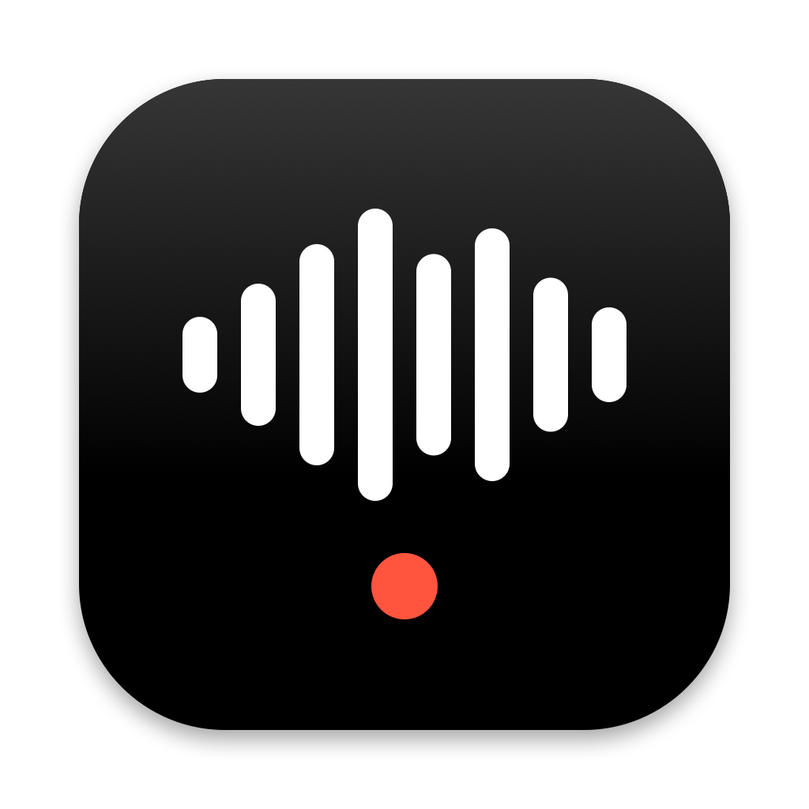
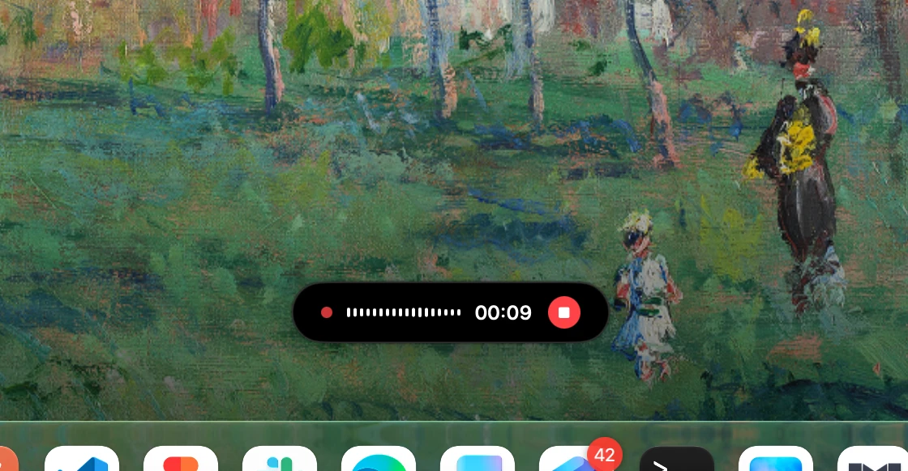
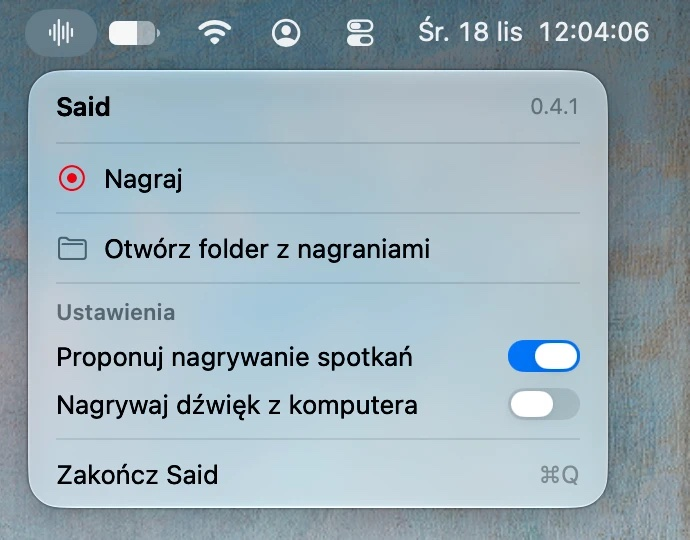

# Said

Said records what you say on your Mac and turns it into text. Click the icon at the top of the screen, talk, click stop. A moment later you have the recording and a transcript, and neither ever leaves your computer.

**Website:** https://rajanbor.github.io/said/ · [po polsku](https://rajanbor.github.io/said/pl/) · [what's new](https://rajanbor.github.io/said/releases.html)

<p>
  
  &nbsp;
  
</p>

*The pill you see while recording, and the menu. The menu is shown in Polish because Said follows your system language.*

## Install

Open Terminal, paste this and press Return:

```bash
curl -fsSL https://raw.githubusercontent.com/rajanbor/said/main/install.sh | bash
```

That's it. It takes a few minutes the first time, because Said is built on your own Mac. You need macOS 14 or newer. If your Mac asks to install Apple's developer tools, say yes and run the command again.

To update later, run the same command.

## Using it

**Recording a thought.** Click the Said icon in the menu bar and choose **Record**. A small black pill appears at the bottom of the screen with a timer and a stop button. Keep working; the pill won't get in your way, and you can drag it wherever you like. Click stop when you're done.

**Recording a call.** When you join a call in Zoom, Teams, Google Meet or similar, Said asks *“Record and transcribe?”*. Click **Record**, and it captures both you and the other people, even if you wear headphones. When the call ends, it stops by itself. Ignore the question and it goes away after 30 seconds.

**Finding your recordings.** Each recording gets its own folder in `Music/Said`, with the audio and a text file of everything that was said, with timestamps. The menu has a button that opens that folder.

**If you forget to stop.** After 2 minutes of silence Said sends a notification with a stop button. If your disk is getting full, it warns you and saves the recording before space runs out.

Before you record other people, let them know.

## Your privacy

- **Recordings stay on your Mac.** No cloud, no account, no analytics.
- **The internet is used once:** to download the speech-recognition model (about 630 MB), when you click the button in the menu. After that Said works offline.
- **Nothing records without you.** Recording starts only when you click. Links that try to start a recording from another app only show a question you have to answer.
- **Only the call is recorded.** For calls, Said captures the meeting app's sound, not your music or notifications. If it can't tell which sound belongs to the call, it records just your microphone.
- **Only you can open the files.** Other people who use this Mac can't get into your recordings folder.

More details are in [SECURITY.md](SECURITY.md).

## How it works, in short

Said turns speech into text with **Whisper**, an openly available speech-recognition model. It runs on your Mac's own chip, the way your Mac edits photos without a server. Ten seconds of audio takes about a second and a half. Whisper understands Polish, English and many other languages, and works out which one you're speaking by itself.

To notice that a call has started, Said only checks which app is using the microphone. It doesn't look at your screen, windows or browser tabs.

## Uninstall

```bash
rm -rf /Applications/Said.app ~/.said "$HOME/Library/Application Support/Said"
```

Your recordings in `Music/Said` stay; delete that folder too if you don't need them.

---

## Under the hood

Said is a native Swift app (SwiftUI + AppKit). Apart from [WhisperKit](https://github.com/argmaxinc/WhisperKit), it uses only Apple's own frameworks.

- **Recording.**
  - The microphone is recorded with `AVAudioRecorder`.
  - For calls, a Core Audio **process tap** (macOS 14.2+) captures only the meeting app's audio, encoded to AAC as it records. It fails closed: no meeting audio means microphone only, never the whole system.
  - The two tracks are mixed into one `.m4a`. Temporary files are deleted only after the result is confirmed playable.
  - Folders are `0700` and files `0600`.
- **Meeting detection.** Every 2 seconds Said asks Core Audio which processes are capturing audio input and matches their bundle IDs against known meeting apps. This needs no permission.
- **Transcription.**
  - The model is **Whisper large-v3 turbo**, converted to Core ML and quantized to about 630 MB. It runs on the Neural Engine and GPU.
  - The model is downloaded only when you click the button. After that it loads with downloads switched off.
  - The transcript is Markdown with timestamps.
- **Permissions.** macOS asks for:
  - the microphone;
  - system audio recording, for calls (this isn't screen recording);
  - notifications.

  Said is signed with a local self-signed certificate kept in its own keychain (`~/.said/signing`, with a random password). Because of that, macOS remembers these permissions across updates.
- **Installer.** It builds the newest release tag from source. It remembers which commit each release pointed to, and refuses to install a release that was later rewritten.
- **Links.** `said://start`, `said://stop` and `said://toggle` work from Shortcuts, Raycast or Terminal (`open said://toggle`). Starting always asks for confirmation; stopping doesn't.

## For developers

Build and run:

```bash
./scripts/build-app.sh --open
```

```
Sources/Said/
  SaidApp.swift          menu bar app, URL handling
  MenuView.swift         menu contents
  PillPanel.swift        floating pills: recording and meeting prompt
  Recorder.swift         recording, files, silence and disk warnings
  MeetingDetector.swift  which meeting app is using the mic
  SystemAudioTap.swift   meeting or system audio (Core Audio process tap)
  AudioMixer.swift       mixes mic + call audio into one .m4a
  Transcriber.swift      WhisperKit: model download, transcription
  Notifier.swift         notifications with a Stop button
  Localization.swift     L("…") lookup for translated text
Resources/               Info.plist, icon, en.lproj, pl.lproj
scripts/build-app.sh     builds and signs build/Said.app
scripts/release.sh       cuts a release
scripts/make-icon.swift  draws the app icon
install.sh               the one-line installer
docs/                    website (English + Polish)
```

**Translations.** Text lives in `Resources/<language>.lproj/Localizable.strings`; the keys are the English text from the code. To add a language:

1. Copy `pl.lproj` to `<code>.lproj` and translate it.
2. Add the code to `CFBundleLocalizations` in `Info.plist`.
3. Rebuild.

Pull requests are welcome.

**Releases.** Said uses [SemVer](https://semver.org/).

1. Add a `## [X.Y.Z] - date` section to [CHANGELOG.md](CHANGELOG.md).
2. Run `./scripts/release.sh X.Y.Z`.

The script bumps the version, checks the build, tags, pushes and creates the GitHub release. When you release, also add a short entry to `docs/releases.html` and `docs/pl/releases.html`.

**Ideas for later:**

- labels for who is speaking (“you” vs “others”);
- meeting notes from a local language model;
- a global keyboard shortcut.

## License

MIT
